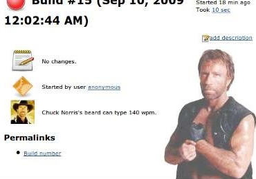
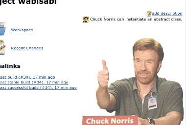
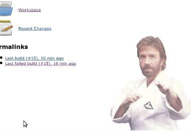

# Chuck Norris plugin for Jenkins

[](https://plugins.jenkins.io/chucknorris)
[](https://github.com/jenkinsci/chucknorris-plugin/releases/latest)
[](https://plugins.jenkins.io/chucknorris)

<a href="https://jenkins.io">
     
</a>

## What it is

This plugin adds an absolutely delightful feature to Jenkins:
depending if your build succeeds, fails, or is unstable,
it will show a picture of Chuck Norris *auto-adapting* (that's right, computer science it is!) to the build result!

Seeing that, already many thousands (yes, *thousands*!) of people have decided to take the plunge and install this plugin to finally see the light.
Why not you?

## Table of Contents

- [Download & Installation](#download--installation)
- [Usage](#usage)
  - [Freestyle / Maven Jobs](#freestyle--maven-jobs)
  - [Pipeline Jobs](#pipeline-jobs)
- [Screenshots](#screenshots)
- [Release Notes](#release-notes)
- [Testimonials](#testimonials)
- [Localization](#localization)
- [Credits](#credits)
- [Maintainer](#maintainer)

## Download & Installation

Install this plugin from the Jenkins Plugin Manager (_Manage Jenkins > Plugins > Available plugins_),
or download the [latest .hpi](https://updates.jenkins.io/latest/chucknorris.hpi) and upload it via _Manage Jenkins > Plugins > Advanced settings_.

## Usage

### Freestyle / Maven jobs

1.  Open the job’s configuration page, click **Add post-build action**, and select **Activate Chuck Norris**.
2.  Save the configuration.
3.  Run a build. After it completes, Chuck Norris (along with a random quote) will appear on the job and build pages.

### Pipeline jobs

Add the `chuckNorris()` step to your Jenkinsfile:

```groovy
pipeline {
    agent any
    stages {
        stage('Build') {
            steps {
                echo 'Building...'
            }
        }
    }
    post {
        always {
            chuckNorris()
        }
    }
}
```

Put `chuckNorris()` in `post { always { ... } }` so Chuck reacts to the final build result.
Calling the step more than once in a run is fine: the latest call replaces the earlier fact.

The step prints the fact to the build log and returns it, so you can reuse it elsewhere:

```groovy
post {
    always {
        script {
            def fact = chuckNorris()
            echo "Today's wisdom: ${fact}"
        }
    }
}
```

### Moods

| Build result          | Chuck's mood                 |
|-----------------------|------------------------------|
| Success               | Thumbs up                    |
| Unstable / running    | Alert                        |
| Failure               | Bad ass                      |
| Aborted / not built   | Disappointed                 |

### Screenshots





## Release Notes

See [GitHub Releases](https://github.com/jenkinsci/chucknorris-plugin/releases).

## Testimonials

-   Uncle Bob Martin said ChuckNorris Plugin [is *very* motivating](https://x.com/unclebobmartin/status/10741488856).

## Localization

Facts are displayed in the user's browser locale when available. Supported languages:

- English (default)
- Italian
- German

Contributions of new translations are welcome — see the `FactGenerator.properties` files under `src/main/resources`.

## Credits

* [Chuck Norris 'The Programmer' facts](https://web.archive.org/web/2020/http://www.codesqueeze.com/the-ultimate-top-25-chuck-norris-the-programmer-jokes)
* [Emotional Jenkins Plugin](https://plugins.jenkins.io/emotional-jenkins-plugin/).

## Maintainer

This plugin is actively maintained. Co-contributors and feedback are welcome — please open an issue or pull request.

---

[Jenkins community](https://www.jenkins.io/participate/) • [Report a bug](https://github.com/jenkinsci/chucknorris-plugin/issues)
